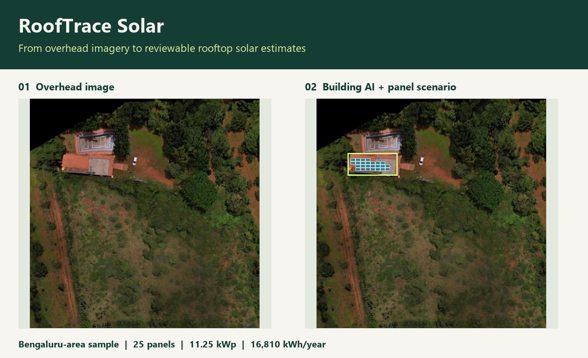

# RoofTrace Solar

### Find a roof. Explore its solar potential.

[](https://github.com/jessesuniljs1-collab/rooftrace-geoai/actions/workflows/checks.yml)
[](LICENSE)

**[Open the live app](https://rooftrace-geoai.vercel.app)** · [Demo guide](docs/JUDGES_GUIDE.md) · [Submission answers](docs/PHASE1_SUBMISSION.md)



*Recorded result from the current Bengaluru-area sample, using real model inference
and PVGIS yield. Panel positions and energy are screening scenarios, not validated
installation designs. Image: DroneMaps.in / Chetan Prasad / Open Imagery Network,
CC BY 4.0; cropped, resampled and annotated by RoofTrace. This image is documentation,
not a cached result served by the app.*

## What it does

RoofTrace finds candidate roof regions in overhead imagery and turns them into
transparent solar estimates. Click a roof to inspect its projected area, panel count,
installed capacity and expected annual electricity. A monthly chart shows seasonal
variation, and every assumption can be reviewed before exporting results.

- **Real building AI:** UNet++ / EfficientNet-B4 segmentation, running on CPU.
- **Click-to-inspect roofs:** individual result cards and ranked roof selection.
- **Automatic sample estimates:** attributed, georeferenced Bengaluru imagery.
- **Physical panel scenarios:** module sizes, setbacks, gaps and roof-coverage limits.
- **Free solar yield:** European Commission JRC PVGIS regional climate calculations.
- **Review and export:** exclusions, threshold controls, annotated PNG, building CSV,
  solar CSV and a full JSON report.

## Try the demo

1. Open the app and choose **Bengaluru rooftops**.
2. Select **Find rooftops**. Building detection and the sample's solar estimate run.
3. Click a highlighted roof to see its own results on the image.
4. Explore the monthly chart or download the results.
5. Open **Adjust location, scale and panel settings** for a different scenario.

For your own JPG/PNG, enter the real location and image scale, or calibrate scale
using a measured distance. Uploads support **64–2048 pixels per side**, up to
**3.5 MB**, with native image coordinates retained inside those limits.

> **kWp** describes installed panel capacity. **kWh/year** describes estimated
> annual electricity. A connected roof region can include adjoining houses.

## Run locally

Use 64-bit **Python 3.12**, a CPU and around 1–2 GB of available RAM.
Internet is needed for initial model setup and PVGIS calculations. No API key is required.

```sh
git clone https://github.com/jessesuniljs1-collab/rooftrace-geoai.git
cd rooftrace-geoai
python -m venv .venv
source .venv/bin/activate
# Windows PowerShell: .venv\Scripts\Activate.ps1
python -m pip install -r requirements.txt
python scripts/download_model.py
python -m uvicorn app:app --host 127.0.0.1 --port 8000
```

Open `http://127.0.0.1:8000`, or use Docker:

```sh
docker build -t rooftrace .
docker run --rm -p 8000:8000 rooftrace
```

## How the estimate is built

| Stage | Method |
|---|---|
| Find candidate roofs | Pretrained WHU-specific UNet++ segmentation |
| Measure projected area | Segmented pixels × verified ground scale² |
| Fit illustrative panels | Mask-contained grid search with setbacks and coverage cap |
| Estimate electricity | Installed kWp × PVGIS-specific monthly/annual yield |
| Review | Select roofs, exclude false positives, change assumptions and export |

The app serves both interface and inference through **FastAPI**, with **ONNX Runtime**,
OpenCV and plain HTML/CSS/JavaScript. The model is downloaded from a checksum-pinned
[public release](https://github.com/jessesuniljs1-collab/rooftrace-geoai/releases/tag/model-v1).
PyTorch is needed only to reproduce conversion. [Full technical reference](docs/TECHNICAL_REFERENCE.md).

## Data and original contribution

The team's work is the application, inference integration, tiling/alignment, physical
panel scenarios, PVGIS integration, interactive inspection and exports. AI coding
assistance was used. We did not train the external building checkpoint.

| Resource | Source and terms |
|---|---|
| Building model | giswqs WHU UNet++ / EfficientNet-B4, Apache-2.0 |
| Bengaluru-area image | DroneMaps.in / Chetan Prasad / Open Imagery Network, CC BY 4.0 |
| Additional samples | WHU hosted test release, CC BY 4.0; public-domain USGS imagery |
| Solar yield | European Commission JRC PVGIS, free public information |
| Adapted geometry | AKASH2907 Project Sunroof India, Apache-2.0 |

Exact URLs, hashes, crop bounds and modifications appear in the
[sample manifest](static/samples/manifest.json) and [third-party notices](THIRD_PARTY_NOTICES.md).
The Google Satellite link provides external visual context. **Google imagery is not
processed, and no Google API billing, OpenAI key or paid inference is used.**
Microsoft building footprints are not required by the current inference path.

## Verification and limits

CI runs **14 Python tests**, interface-state checks, secret scanning, Docker startup
and real inference. A separate [public verification workflow](https://github.com/jessesuniljs1-collab/rooftrace-geoai/actions/workflows/public-smoke.yml)
checks the deployed endpoints. The roof-click result card is covered by a DOM test.
Native Chrome visual verification was attempted but blocked by the automation
helper's URL check; visual layout is not claimed as fully verified.

These estimates support first-pass review. Segmentation can merge or split roofs;
scale errors affect area; actual obstacles, nearby shade, roof structure and installation
requirements need site assessment. PVGIS represents regional climate and terrain.
No guaranteed production, savings or installation approval is claimed.

Uploaded images remain request-local and are not retained on disk. Coordinates and
numeric scenario settings go to PVGIS; imagery does not. No secrets are needed by
the app. [Credential audit](docs/security-audit.json).

## Team

**404: JCT Not Found** · IEEE Week 2026 GeoAI Hackathon

**Jesse Sunil** (team leader), **Charan SC**, **SM Tejashree Kashyap**

Assigned **Problem 13 — Satellite Image Intelligence**.

Original application source is **MIT**. Models, adapted geometry and imagery retain
their separate licenses. See [LICENSE](LICENSE) and [third-party notices](THIRD_PARTY_NOTICES.md).
