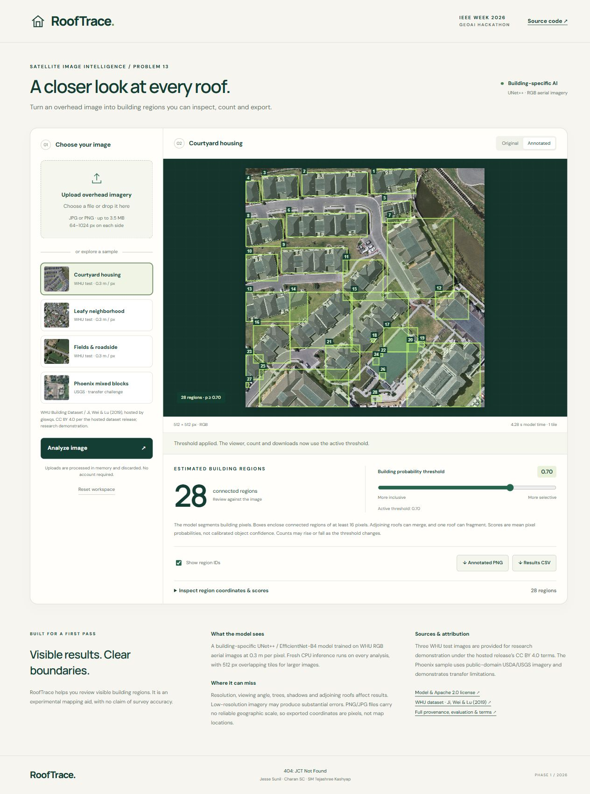
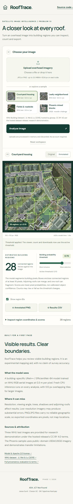

# RoofTrace Phase 1 submission

Prepared **16 November 2026 (IST)** for IEEE Week 2026 GeoAI Hackathon.
The form itself has **not** been submitted.

## Copy-ready form answers

**Team Name**

404: JCT Not Found

**Team Leader Name**

Jesse Sunil

**Assigned Problem Statement**

Problem 13 — Satellite Image Intelligence

**Project Title**

RoofTrace — Building Detection from Satellite Imagery

**Live Deployed Application Link**

https://rooftrace-geoai.vercel.app

**Public GitHub Repository Link**

https://github.com/jessesuniljs1-collab/rooftrace-geoai

**Brief Description of Core User Flow and Data Sources Used**

Users upload a JPG/PNG overhead image or choose an attributed sample, then run
building segmentation using a pretrained WHU-specific UNet++/EfficientNet-B4 model
with ONNX Runtime. RoofTrace displays aligned region boxes, an estimated connected
building-region count and mean pixel probabilities. Users adjust the probability
threshold and download an annotated PNG and pixel-coordinate CSV. Three demo
images come from the provider-declared WHU test split (hosted release: CC BY 4.0);
a separate public-domain USDA/USGS Phoenix image demonstrates transfer limitations.
The external model was trained on WHU imagery. Adjoining roofs may merge, so counts
are estimates for human review.

**Confirmation that the deployment and repository are publicly accessible without
login barriers and reflect our team's original work**

Yes. The live production application and public repository were verified without
evaluator authentication. RoofTrace's application, processing pipeline, interface
and exports are our team's original integration work, developed with AI coding
assistance. The external pretrained model, libraries and sample images are clearly
identified, licensed and attributed; we do not claim to have trained the model or
created the source imagery.

**Checkbox guidance: supported.** Check the confirmation for this educational
research submission. This confirms original application work with disclosed
third-party assets, not original ownership of the pretrained model or datasets.

## Handoff

- **Deployment:** complete, HTTPS, Vercel **Hobby** free tier, one FastAPI service.
  No paid plan, add-on or hosted inference API was purchased. Model weights are
  included at build time. Production access works without login. Preview URLs may
  use Vercel authentication; submit the stable production link above.
- **Repository:** public under the authenticated personal account
  `jessesuniljs1-collab`. Source, pinned direct dependencies, Dockerfile, setup,
  third-party notices, conversion manifest, evaluation and CI are included.
- **Model delivery:** an 80 MB ONNX artifact is distributed separately through the
  public `model-v1` GitHub release and SHA-256 verified. The source repository has
  no large model binaries, private uploads, labels, credentials or temporary output.
- **Stack change:** building-specific semantic segmentation replaces the proposed
  fine-tuned YOLO/SpaceNet approach. ONNX Runtime replaces PyTorch in production;
  PyTorch remains available for reproducible conversion. No new training was done.
- **Public API evidence:** `public-verification.json` records successful no-auth
  homepage/health checks, all four sample inferences, uploaded PNG/JPG inference,
  filtering, valid zero output, corrupt-file and oversize rejection, and public
  repository visibility. Its timestamps and latency are actually measured.
- **Browser evidence:** local sample and upload flows, visible loading feedback,
  aligned boxes, threshold updates, original/annotated comparison, reset, exported
  CSV and PNG, laptop and phone layouts were inspected. Public UI inference and
  downloads were also exercised. Screenshots are included with this handoff.
- **Automated verification:** GitHub Actions installs a fresh Linux environment,
  acquires the model, runs Ruff, JavaScript syntax validation and eight targeted
  tests including real inference. It also builds the Docker image and exercises
  container startup and sample inference. See the repository's latest successful
  [Application checks](https://github.com/jessesuniljs1-collab/rooftrace-geoai/actions/workflows/checks.yml).
- **Operations:** the attempted GitHub-to-Vercel automatic repository connection
  was unavailable with the current integration permissions. This does not affect
  the working deployment or CI. Redeploy source changes with the authenticated
  Vercel CLI; the setup and model acquisition are in version control.
- **Credentials:** Gitleaks 8.30.1 scanned the full Git history with zero findings;
  supplemental source, deployed-asset and completed-CI-log checks found no exposed
  keys. Vercel has no project environment variables, and GitHub has no repository
  Actions secrets configured. Sensitive-file URL probes return 404. The app needs
  no OpenAI, Vercel or Hugging Face API keys. Full-history secret scanning is now
  part of CI, with findings redacted. See `security-audit.json`.

## Material limitations

1. **Region estimates, not verified building instances.** Adjacent roofs can merge
   and individual roofs can split. The score is mean pixel probability. Threshold
   0.50 is a conventional default, not a validation-calibrated object confidence.
2. **Limited transfer.** The model expects detailed overhead RGB imagery similar
   to WHU at 0.3 m/pixel. Low resolution, oblique views, trees, shadows and different
   architecture can cause substantial misses or false regions. The USGS scene
   intentionally exposes this problem. No Bengaluru accuracy claim is made.
3. **Small evaluation.** Six provider-designated WHU test tiles yielded 87.35%
   region precision, 87.88% recall, and mean absolute region-count error 1.17 at
   mask IoU ≥ 0.50. Median local warm model inference was 0.639 seconds with two
   CPU threads. This is a small diagnostic with demo overlap, not an independent
   geographic benchmark. Public server timings differ; see the measured report.
4. **Bounded processing.** JPG/PNG only, up to 3.5 MB, 64–1024 px per side, maximum
   1,048,576 pixels. Crop larger scenes first. Supported images use 512 px tiles
   with overlap. Exports use original EXIF-oriented pixel coordinates, without GIS
   georeferencing. Up to 5,000 retained components; one inference per process,
   with a retry message under contention.
5. **Free host and provenance.** Cold starts and free-tier quotas can affect
   availability. WHU's hosted release declares CC BY 4.0; the inaccessible original
   provider has historically described research/non-commercial use. This educational
   demo preserves attribution and discloses that distinction. Re-check upstream
   terms before commercial reuse. No third-party ownership is claimed.

No mandatory Phase 1 deliverable remains blocked. Submit the form yourself using
the verified production and repository URLs above.
